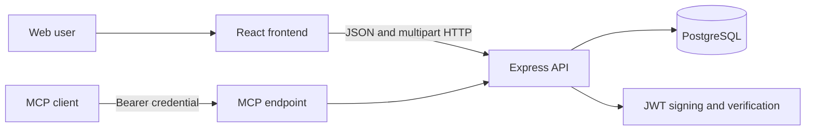

# Project Tracker architecture

> **Status:** Current implementation
>
> **Verification basis:** Working tree based on the current branch

## 1. Executive summary

Project Tracker is a project and task-management web application. A React frontend talks to an Express API, which stores its operational data in PostgreSQL. The API also exposes an MCP endpoint for compatible clients, with every request constrained by the authenticated user’s project memberships.

The frontend is not a security boundary. The API must authenticate every protected request and check the caller’s project membership or admin role before reading or changing data.

## 2. System context

The frontend runs on port `3000` during development. The API runs on port `5000` by default. PostgreSQL is configured through `DATABASE_URL`.

## 3. Architectural invariants

1. Passwords and refresh tokens are stored only as hashes in PostgreSQL. `AuthService` uses bcrypt and rotates refresh tokens.
2. Protected API routes require a valid bearer token. The authentication middleware attaches the authenticated user only after JWT or opaque MCP credential validation succeeds.
3. Project membership controls project and task access. The project and task services enforce this rule before returning or changing project data.
4. MCP credentials are opaque `mcp_...` values. PostgreSQL stores only a SHA-256 hash, rejects revoked or expired credentials, and records last use.
5. The dedicated automation account is a normal user with project memberships, not an administrator. New projects add it when it exists unless `addAutomationMember` is explicitly false.
6. Tasks have one project and a constrained status: `todo`, `in_progress`, `code_review`, `completed`, or legacy `done`.

## 4. Components and dependencies

- `backend/src/server.ts` opens the PostgreSQL connection and starts Express. It owns neither routes nor domain rules.
- `backend/src/config/db.ts` owns the PostgreSQL pool. `backend/src/services/postgres.ts` owns common IDs, error construction, and data mapping.
- `backend/src/services/` owns persistence and domain rules for authentication, users, projects, tasks, and dashboard data.
- `backend/src/mcp/` adapts the shared services to MCP. It does not bypass membership rules with raw database access.
- `backend/src/middleware/` authenticates, validates, rate-limits, and formats errors at the HTTP boundary.
- `frontend/src/` owns browser rendering, interaction state, and API calls. It does not own authorization rules.

## 5. Critical flows

### Web authentication

The API compares the supplied password to the stored bcrypt hash, issues a short-lived JWT, and stores a rotated refresh-token hash. Browser requests send the JWT as a bearer token.

### Project and task access

An admin can create a project. The creator becomes a member, and the configured MCP automation account is added by default. Task services verify membership before creating, changing, assigning, commenting on, uploading images to, or deleting a task.

### MCP automation

`mcp-token:provision` creates the `MCP Automation` user when needed, adds it to all existing projects, and writes a newly issued raw credential to an ignored local file. An MCP request hashes its bearer credential and finds the active token and user in PostgreSQL. The MCP tools then use the same project and task services as the web API. Revoking the token changes `revoked_at`, causing later requests to fail closed.

## 6. Interfaces and data

The HTTP API remains under `/api`; the MCP endpoint is `POST /mcp`; health is `GET /health`.

PostgreSQL tables include `users`, `projects`, `project_members`, `tasks`, `task_images`, `task_comments`, `task_activities`, and `api_tokens`. Identifiers remain 24-character hexadecimal strings so migrated records and frontend contracts stay compatible.

## 7. Security and operations

`JWT_SECRET`, `DATABASE_URL`, and raw MCP tokens are secrets and must not be committed. Deployments must use HTTPS for `/mcp` and preserve the `Authorization` header. Run [MCP server](docs/mcp.md) for credential provisioning, rotation, and revocation steps.

The backend exits if PostgreSQL cannot be reached at startup. The local MongoDB source is retained only as a rollback and migration source; it is no longer the runtime database.

## 8. Verification and known limitations

The backend TypeScript build passes. PostgreSQL MCP read, task-write, automatic-membership, and immediate-token-revocation flows have been manually verified against the local database.

The existing Jest suite still has MongoDB-era tests and has not yet been migrated to an isolated PostgreSQL test database. Browser end-to-end coverage is also not present.

## 9. Source map

- [backend/src/config/db.ts](backend/src/config/db.ts): PostgreSQL connection pool.
- [backend/scripts/postgres-schema.sql](backend/scripts/postgres-schema.sql): schema and indexes.
- [backend/src/services/](backend/src/services/): domain and persistence rules.
- [backend/src/mcp/](backend/src/mcp/): MCP transport and tools.
- [backend/scripts/provision-mcp-automation.cjs](backend/scripts/provision-mcp-automation.cjs): dedicated-account and credential provisioning.
- [backend/scripts/revoke-mcp-token.cjs](backend/scripts/revoke-mcp-token.cjs): credential revocation.
